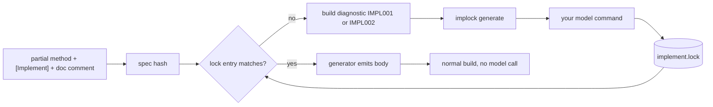

<!-- readme:header:start -->
<p>
  
  <a href="https://github.com/Egoushka/implock/actions/workflows/ci.yml"></a>
  
</p>
<!-- readme:header:end -->

# implock

> Write a C# method signature and a doc comment once; a model writes the body once, and a committed lock file keeps it, so builds never call a model.

<!-- readme:status:start -->
**Active**. I work on it this month.
<!-- readme:status:end -->

Code is the spec. A partial method marked `[Implement]` is the spec: its signature, its XML doc comment and optional named tests. A model fills in the body one time, and the body goes into `implement.lock`, which you review and commit like any other file. A Roslyn source generator (a compiler plug-in that adds code at build time) emits the body from the lock. Change the spec and the entry goes stale, so the build tells you.



## Why

Model-written code is easy to get and hard to trust twice: regenerate it and the body changes, and nothing records what the model was asked. I wanted the spec to stay in the source and the answer to stay in version control, with the model used at one moment and never in the build.

## What it does

- `[Implock.Implement("name: Call(1) == 2", ...)]` on a bodiless partial method marks it as a spec.
- The generator hashes the spec (SHA-256 over the normalized signature, doc comment and attribute arguments) and emits the body stored under that hash.
- Missing, stale and orphaned entries are compiler diagnostics: IMPL001, IMPL002 and IMPL003. A malformed lock or a body that does not parse is IMPL004.
- `implock generate` asks a model command for each missing body, checks that it compiles, and writes the lock. The lock is plain text and deterministic, so a diff shows exactly what changed ([ADR 0001](docs/adr/0001-lock-format.md)).
- `implock report` compares a hand-written body with a generated one and lists the input classes where the original rejects and the generated body accepts: the places the model is looser than you were.

Not here: no API client, no network code and no keys. The model is a command you name; `implock` pipes the prompt to its stdin and reads the body from its stdout. It is not published to NuGet yet.

## Quick start

Needs the .NET 10 SDK. From a clean clone:

```bash
git clone https://github.com/Egoushka/implock && cd implock
dotnet build -c Release
dotnet run --project src/Implock.Cli -- check samples/Implock.Sample   # exit 0: the lock is complete
dotnet run --project samples/Implock.Sample                            # runs the generated bodies
dotnet run --project src/Implock.Cli -- report --original samples/report/Original.cs \
  --generated samples/report/Generated.cs --method ReportSample.Slugs.Slug
```

The spec in your code, from `samples/Implock.Sample/Text.cs`:

```csharp
/// <summary>Counts the words in the text. Words are separated by one or more spaces.</summary>
[Implock.Implement("counts: WordCount(\"a  b c\") == 3", "empty: WordCount(\"\") == 0")]
public static partial int WordCount(string text);
```

Add a body with `implock generate samples/Implock.Sample --model "your-command"`. The default model command is `claude -p`; `IMPLOCK_MODEL` and `--model` override it. `--prune` drops lock entries whose method no longer exists. `--regen ID[,ID...]` regenerates the listed methods (ids as written in `implement.lock`, separated by commas outside `<>`, `()` and `[]`) even when their lock entry is current; an empty list or an id that names no `[Implement]` method exits 2, and a refused body leaves the previous entry in place. The prompt carries signature-only outlines (no bodies) of the containing type's other members, of the project types used in the method's signature, and, one level deeper, of the project types those outlines' members name; the spec hash does not include them. Exit codes: 0 ok, 1 findings, 2 usage or failure.

## How it works

The generator never reads a model; it reads `implement.lock` from the project's `AdditionalFiles`, keyed by method id and spec hash. The CLI is the only place a model is called, and it runs the generator again over the new entry before it saves it. A body is refused if it does not parse or if the generated file has compile errors.

`report` compiles both files in memory, draws inputs for every parameter by class (empty, whitespace, small, large, negative and so on, capped at 5000 combinations, fixed by `--seed`), runs both methods and classifies each class as looser, stricter, differs or agree.

Limits, stated plainly:

- Project loading reads the `.cs` files in one directory. It references the runtime's assemblies and, when the project has been restored, the compile assemblies its NuGet packages list in `obj/project.assets.json`; it never restores or downloads anything. Project-to-project references, framework references beyond the runtime's own (such as ASP.NET Core) and a custom intermediate output path are not seen, so a spec whose signature uses such a type cannot be locked: `generate` refuses it, exits 2 and suggests `dotnet restore` when the assets file is missing or incomplete. Compiler settings (`Nullable`, `ImplicitUsings`, `TreatWarningsAsErrors`, `WarningsAsErrors`, `WarningsNotAsErrors`, `NoWarn`, `WarningLevel`) come from the unconditional property groups of the project file and its `Directory.Build.props` chain, with `$(Property)` references expanded, and are handed to the C# compiler's own option parser, so `nullable`, bare numbers and either separator mean what they mean to `csc`; a value `csc` rejects exits 2. Without `WarningLevel`, the level follows the SDK's rule: 9999 under `AnalysisLevel` `preview`, 4 for .NET Framework, the target's major version for .NET 5 and later or .NET Core, and 4 otherwise; with several targets, the highest of them. Conditions, imports and property functions are not evaluated. Verification counts compile errors only, not behaviour, so a warning the build turns into an error is refused and a plain warning is kept.
- `report` handles static, non-generic methods whose parameters are string, int, long, double, bool or char. Fuzzing finds only what the input classes and seed reach, so no finding is not a proof.
- The sample bodies in `samples/Implock.Sample/implement.lock` came from a scripted stand-in command, not a real model.

## Numbers

| Claim | Value | Source |
|---|---|---|
| Automated tests | 97, 0 failed | `dotnet test` on this commit |
| Planted looser cases found in the sample pair | 3 input classes of 48 | `implock report` on `samples/report` |
| Looser classes for an identical pair | 0 | `ReportTests` in `tests/Implock.Cli.Tests` |

## Docs

- [ADR 0001: lock format](docs/adr/0001-lock-format.md): why a plain-text lock.
- [THREAT-MODEL.md](THREAT-MODEL.md): prompts built from source, model output that gets compiled, dependencies, workflows.
- [CLAUDE.md](CLAUDE.md): commands that prove a change and the engineering contract.

## License

MIT, see [LICENSE](LICENSE).

<!-- readme:footer:start -->
---

<sub>Made by [Yehor Hrabovskyi](https://hrabovskyi.online) · [MIT licence](LICENSE).</sub>
<!-- readme:footer:end -->
