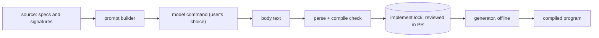

# Threat model

## 1. What are we working on

A source generator that emits method bodies from `implement.lock` at build time, and a CLI that asks a model command for missing bodies. Assets: the integrity of code that gets compiled and run, and the contents of the developer's source, which are sent to the model. There is no server, no account and no network code in this repo; the model is a command the user names.

## 2. What can go wrong

| Threat | Where |
|---|---|
| Prompt content built from source code leaks secrets or private code to the model provider | `PromptBuilder` sends the spec: namespace, enclosing type headers, doc comment, signature, named tests |
| Instructions hidden in a doc comment steer the model (prompt injection through source) | any spec text |
| Model output is hostile or wrong code that then gets compiled and run | `generate`, then every build |
| A lock edited by hand or by a bad merge injects code without a model | `implement.lock` |
| The model command string runs arbitrary programs | `--model`, `IMPLOCK_MODEL` |
| A vulnerable or tampered dependency, or a mutable CI action | NuGet packages, workflows |
| `report` runs untrusted code: it loads and executes the two files it compares | `implock report` |

## 3. What we do about it

- The prompt carries only the spec: namespace, enclosing type headers, doc comment, signature and named tests, never environment variables, files outside the project or the lock of other projects. The README says what is sent. The model command is the user's, so where the prompt goes is the user's choice.
- Model output is untrusted text. `ModelOutput` strips fences, `BodyValidator` requires the text to parse as statements, and `generate` re-runs the generator and rejects the body on any compile error before the lock is written.
- The lock is committed and reviewed like code; the generator is offline and deterministic, so a changed body always shows in a diff. Each entry is bound to a spec hash, so an edited spec makes its entry stale (IMPL002) rather than silently reused. Reviewing the lock diff is the control that matters: compiling is not proof the body is safe.
- The CLI takes the model command as a string from the user and runs it without a shell wrapper of its own; it never builds that command from source contents.
- `report` executes code, so it is for files you trust, the same as building them.
- Dependencies are pinned in central package management and checked with `dotnet list package --vulnerable --include-transitive` (no findings at this commit). Workflow actions are pinned by commit SHA, permissions are `contents: read`, and checkout does not persist credentials.

## 4. Did we do a good enough job

Not audited: a deep security audit has not been run, and the model command's own data handling is out of scope. Compile success is a weak check for hostile bodies; the human review of `implement.lock` is the real gate. Re-run this model when the prompt contents, the lock format or the CLI's process handling change.
